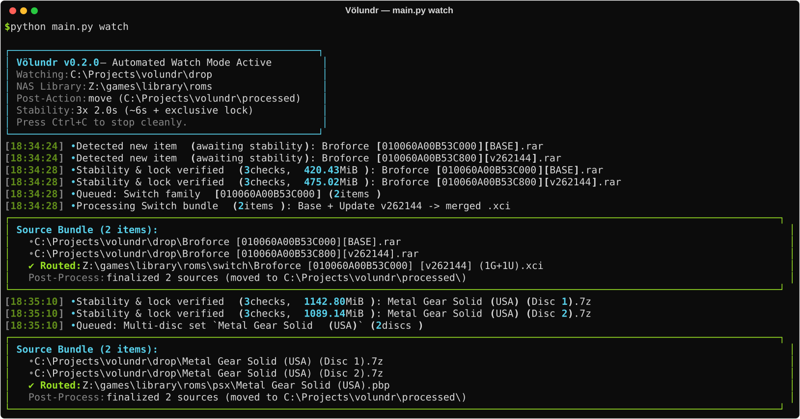

# Völundr

[](https://younglordace.github.io/volundr/)
[](LICENSE)

**Drop ROM archives in -> get clean, compressed, emulator-ready games sorted into your library automatically.**

Völundr is a cross-platform Python 3.11+ automated ROM ingestion pipeline for **Windows**, **Linux**, and **Docker**. Drop `.zip`, `.7z`, `.rar`, raw disc images, or folders into `./drop` and Völundr identifies the console, converts to the optimal format (`.chd`, `.pbp`, `.rvz`, `.xci`, `.cci`, `.wua`, Vita3K `.zip`), and moves everything safely into your local folder or NAS.

**Full Documentation:** [younglordace.github.io/volundr](https://younglordace.github.io/volundr/)



---

## Quick Start (3 Steps)

1. **Clone the repository:**
   ```bash
   git clone https://github.com/YoungLordAce/volundr.git
   cd volundr
   ```

2. **Run the guided setup script** *(requires Python 3.11+)*:
   ```bash
   python setup_volundr.py
   ```
   It walks you through creating `.venv`, generating `config.toml` with your ROM library folder, downloading official third-party tools into `./tools/` (you can pick **All** or **Choose by console**), auto-creating `./drop`, `./processed`, `./quarantine`, and `./.staging`, and running `main.py doctor` to verify everything.
   *(Want to preview first without downloading anything? Run `python setup_volundr.py --dry-run`.)*

3. **Drop ROMs into `./drop` and start watching:**
   ```bash
   # Windows
   .\.venv\Scripts\python.exe main.py watch

   # Linux / macOS
   ./.venv/bin/python main.py watch
   ```

<details>
<summary><strong>Manual Setup (without the setup script)</strong></summary>

1. **Create a virtual environment and install dependencies:**
   ```bash
   python -m venv .venv

   # Windows (PowerShell)
   .\.venv\Scripts\python.exe -m pip install -r requirements.txt

   # Linux / macOS
   ./.venv/bin/pip install -r requirements.txt
   ```

2. **Create your local `config.toml`:**
   ```bash
   # Windows (PowerShell)
   Copy-Item config.example.toml config.toml

   # Linux / macOS
   cp config.example.toml config.toml
   ```
   Open `config.toml` and set **`library_root`** under `[paths.windows]` or `[paths.linux]` to your destination ROM folder (local drive, mapped NAS drive, UNC share, or Linux `smb://` URI). Optionally change `watch_dir` if you want to watch a folder other than `./drop`.

3. **Download any external tools you need** from the table below into `./tools/` (or onto your system `PATH`).

4. **Verify your setup** *(automatically creates `./drop`, `./.staging`, `./processed`, and `./quarantine`)*:
   ```bash
   # Windows
   .\.venv\Scripts\python.exe main.py doctor

   # Linux / macOS
   ./.venv/bin/python main.py doctor
   ```

</details>

> **Running on a NAS / Docker?** The included [`Dockerfile`](Dockerfile) pre-installs almost every tool automatically. See the **[Docker & NAS Guide](https://younglordace.github.io/volundr/docker-nas/)** for details.

### Updating
Because your `config.toml`, `.venv`, downloaded tools, and keys are gitignored, you never need to re-clone. Simply run inside your `volundr` folder:
```bash
git pull
# Optional: refresh Python dependencies or check for new tools
python setup_volundr.py --skip-tools
```

---

## External Tools

Völundr checks both your system `PATH` and the `./tools/` folder automatically. Only download the tools for the systems you plan to ingest:

| Tool | Needed For (ROMs / Formats) | Official Download | Where to Place It |
| :--- | :--- | :--- | :--- |
| **7-Zip** (`7z` / `7zz`) | Extracting & peeking `.7z`, `.rar`, `.zip` archives *(recommended for all systems)* | [7-zip.org](https://www.7-zip.org/download.html) / [ip7z/7zip Releases](https://github.com/ip7z/7zip/releases) | **Win:** `tools/7z/7z.exe` *(or standard `C:\Program Files\7-Zip\` install)*<br>**Linux:** `tools/7z/7zz` *(recommended for `.rar`)* or `PATH` |
| **chdman** | **PS1** (single-disc), **PS2**, **PSP**, **Saturn**, **Dreamcast**, **Sega CD**, **PC Engine CD** -> `.chd` | [MAME GitHub Releases](https://github.com/mamedev/mame/releases) *(extract `chdman.exe` from the Windows release)* | **Win:** `tools/chdman/chdman.exe`<br>**Linux:** install `mame-tools` on `PATH` |
| **PSXPackager** | **PS1 (multi-disc)** -> single `.pbp` with built-in disc switching | [RupertAvery/PSXPackager Releases](https://github.com/RupertAvery/PSXPackager/releases) | **Win:** `tools/psxpackager/psxpackager.exe` (+ `Resources/`)<br>**Linux:** `tools/psxpackager/psxpackager` *(needs `.NET 10` runtime)* |
| **DolphinTool** | **GameCube** & **Wii** -> `.rvz` | [Dolphin Downloads](https://dolphin-emu.org/download/) *(included in release zip)* | **Win:** `tools/dolphin/DolphinTool.exe` *(or Dolphin on `PATH`)*<br>**Linux:** install `dolphin-emu-tool` on `PATH` |
| **NSC_Builder** (`squirrel`) / **nsz** | **Nintendo Switch** -> merged `.xci` (Base + Update + DLC) & `.nsz`/`.xcz` decompression | [julesontheroad/NSC_BUILDER](https://github.com/julesontheroad/NSC_BUILDER) / [nicoboss/nsz](https://github.com/nicoboss/nsz) | **Win:** `tools/nscb/ztools/squirrel.exe`<br>**Linux:** `tools/nscb/ztools/squirrel.py` or `pip install nsz` |
| **ZArchive** *(optional)* | **Wii U** Loadiine folders -> `.wua` *(falls back to clean folders if absent)* | [Exzap/ZArchive Releases](https://github.com/Exzap/ZArchive/releases) | **Win:** `tools/wiiu/zarchive.exe`<br>**Linux:** `tools/wiiu/zarchive` or `PATH` |
| **CDecrypt** *(optional)* | **Wii U** encrypted WUP/NUS (`title.tmd`) decryption | [VitaSmith/cdecrypt Releases](https://github.com/VitaSmith/cdecrypt/releases) | **Win:** `tools/wiiu/cdecrypt.exe`<br>**Linux:** `tools/wiiu/cdecrypt` or `PATH` |
| **pkg2zip** *(optional)* | **PS Vita** Sony `.pkg` -> Vita3K-installable `.zip` | [lusid1/pkg2zip Releases](https://github.com/lusid1/pkg2zip/releases) | **Win:** `tools/psvita/pkg2zip.exe`<br>**Linux:** `tools/psvita/pkg2zip` or `PATH` |

*Cartridge systems (**NES, SNES, N64, GBA, NDS**) and **Arcade** sets (**CPS1/2/3, Neo Geo, FBNeo**) work out of the box—just 7-Zip if they arrive inside `.7z`/`.rar` archives.*

### Optional User-Supplied Console Keys & Databases

Supply your own files dumped from hardware you own (everything inside `tools/` is gitignored):

| System | Files | Where to Place Them | What It Enables |
| :--- | :--- | :--- | :--- |
| **Nintendo Switch** | `prod.keys` *(or `keys.txt`)* | `tools/nscb/ztools/` *(or `~/.switch/prod.keys`)* | Required by `squirrel` for Switch `.xci` merging & `.nsz` decompression *(Völundr auto-copies `prod.keys` → `keys.txt`)* |
| **Nintendo 3DS** | `aes_keys.txt` or `boot9.bin` | `tools/3ds/` | Auto-decrypts encrypted `.3ds` dumps to `.cci` for Azahar *(ZeroKey dumps work without keys)* |
| **PS Vita** | `PSV_GAMES.tsv`, `PSV_DLCS.tsv`, `PSV_UPDATES.tsv` | `tools/psvita/` | Automatic `zRIF`/`work.bin` license generation and title normalization for `.pkg` files |

---

## Everyday Commands

| Command | What It Does |
| :--- | :--- |
| `python main.py doctor` | Checks Python deps, external tools, disk space, and write access to `library_root` |
| `python main.py inspect <path...>` | Read-only preview showing detected system and planned action |
| `python main.py process <path...> [--dry-run]` | Ingest specific file(s) or folder(s) (`--dry-run` previews without changing files) |
| `python main.py scan [--dry-run]` | One-shot pass over everything currently in `./drop` |
| `python main.py watch` | Continuous watcher that automatically processes anything dropped into `./drop` |

---

## Detailed Documentation

Browse the full documentation site at **[younglordace.github.io/volundr](https://younglordace.github.io/volundr/)** (source in [`docs/`](docs/)) for:
- **[Supported Consoles](https://younglordace.github.io/volundr/consoles/):** Per-console conversion rules, multi-disc `.pbp` vs `_discs/` + `.m3u`, CUE healing, Switch donor caching & duplicate update skip, 3DS/Wii U/PS Vita behavior
- **[Docker & NAS](https://younglordace.github.io/volundr/docker-nas/):** 24/7 headless Docker deployment, Syncthing atomic transfers, and ROMarr two-library integration
- **[Configuration](https://younglordace.github.io/volundr/configuration/) & [Architecture](https://younglordace.github.io/volundr/architecture/):** Full `config.toml` reference, `src/` module map, and running tests

---

## Note & Disclaimer

> **Project Status:** This is a personal homelab project shared as-is under the [MIT License](LICENSE). Pull requests and bug reports are welcome; support is best-effort.
>
> **Disclaimer:** Völundr includes **no** copyrighted ROMs, BIOS files, console decryption keys, license databases, or third-party executables. You must supply your own legal dumps, keys dumped from hardware you own, and third-party CLI tools.

## License

Licensed under the [MIT License](LICENSE).
